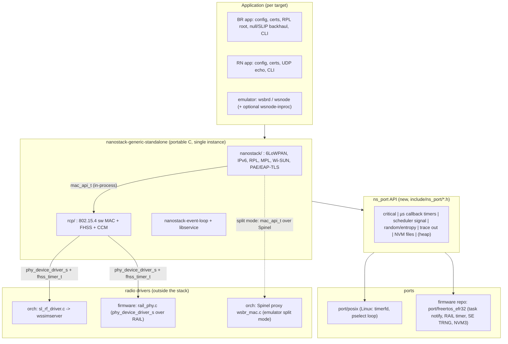

# Making the extracted Nanostack generic: plan and specification

Proposal written 2026-10-22; progress below. Internal engineering (emulator and test tooling), not product work.

## Progress

| Steps (§6) | Status |
| --- | --- |
| S1: porting API headers | **Done** (2026-10-23). `include/ns_port/*.h`; the stack includes them instead of the port's `common/*.h`; the `rand_*` API moved to `include/ns_rand.h`. Gate G1: all 317 stack objects identical to the reference |
| S2: split `rand.c` and `os_types.h`, FHSS timer into the port, `port/linux` → `port/posix` | **Done** (2026-10-23). Gate G1 for the stack objects; moved functions identical apart from the intended changes; G3: 5 + 5 `dag_simple` runs, 66/70 routers ready against 64/70 for the reference, median ready time 144 s against 152 s, no parent outside the topology |
| S3: port chosen at build time, mbedTLS from the consumer, one `rf_driver_storage.c` in-process, cross-build check | **Done** (2026-10-23). `NANOSTACK_PORT`, `NANOSTACK_FILE_NO_STDIO` (firmware patch 0001), `nanostack_add_rcp_library(... INPROCESS)` (patch 0002 in another form), `tests/cross` and a GitHub workflow. The firmware now builds the stack with `add_subdirectory()` and drops its workarounds |
| S4: POSIX `ns_port_run()` with fd hooks, timer IDs by index | **Done** (2026-10-26). G1 for the stack objects; G3: 5 runs, 63/70 routers ready against 64/70, median 152 s against 152 s. `ns_port_init()` joined the API (§3.1.3). The three emulator programs register their inputs in their old order; wsbrd keeps its old poll timeout (`ns_port_posix_set_poll_timeout()`) |
| S5: `wsnode-inproc`, `wsbrd-inproc` | **Done** (2026-10-26). G3: mixed runs (split BR, in-process routers) 66/70 ready, median 137 s; all in-process 66/70, median 148 s; no parent outside the topology. The emulator's default stays the split mode (§4.2). `sl_rf_driver.c` takes its context from `g_rf_host`; `sl_rf_inproc.c` creates the radio and MAC, and keeps the neighbour list the CCA uses |
| S6–S10 (EFR32FG25 FreeRTOS firmware) | **Done** in [`nanostack-efr32fg25-freertos`](https://github.com/YannCharbon/nanostack-efr32fg25-freertos). Two BRD4271A kits (Wi-SUN EU) form a valid network on 3 cold boots. Deviations from §5 are listed in that repo's README, "Design notes" |
| S11 (optional extras) | Not started. Measurements on two boards are done: ACK turnaround, timer lateness, drift, heap |

The order constraint in §6 ("S5 before S10") was not followed: the firmware was brought up first, building the stack from this repo's source lists with its own port. S1–S3 then made that boundary explicit and absorbed the firmware's patches.

The workspace-level tracker is `documents/pre-study/STATUS.md` in [`mesh-emulator-rework`](https://github.com/YannCharbon/mesh-emulator-rework).

Scope: workstream "separate the stack from the emulator and make it generic".
This builds on, and does not repeat:

- `documents/pre-study/investigation/Investigation_Nanostack_Emulator.md` §4;
- `documents/pre-study/investigation/reports/q4_coupling.md`;
- `documents/pre-study/investigation/reports/q4_architecture.md`;
- `documents/pre-study/legal/MSLA_License_Review.md`.

Unless noted, paths are relative to:

- `nanostack-generic-standalone/` (the stack);
- `mesh-emulator-orchestrator/` (abbreviated **orch/**).

Line numbers refer to the current trees: stack = extraction of `wisun-mbed-simulator` `d86eb34`.

Measurement artefacts were kept in a session scratch directory, not committed, and are not preserved. The firmware repo supersedes them. They were:

- `build.sh`: cross-compile script;
- `proto/app_inproc.c`: in-process BR/RN link prototype;
- `proto/port_stub.c`: port stubs;
- `proto/*.map`: link maps;
- `proto/mapsum.py`: per-component size summary.

---

## 1. Summary

**The stack is already close to portable.** Two tests show it:

- **Cross-compile.** All 128 BR objects, 124 RN objects, 21 RCP objects (MAC, FHSS, CCM) and the event loop and libservice build unchanged with `arm-none-eabi-gcc 14.2` for Cortex-M33.
- **Link prototype.** A single-image Wi-SUN node links the host stack and the `rcp/` MAC/FHSS together, without the Spinel proxy. It does so with no missing symbols other than these:
  - **Port layer, 9 symbols:**
    - `platform_critical_init`, `platform_enter_critical`, `platform_exit_critical`;
    - `eventOS_callback_timer_register`, `_unregister`, `_start`, `_stop`;
    - `eventOS_scheduler_signal`;
    - `rand_get_n_bytes_random`.
  - **Portable helpers:** the other `rand_*` functions.
  - **Two objects the application or board supplies:** a `phy_device_driver_s` radio driver and an `fhss_timer_t`.

**The work is mainly about isolating the remaining Linux leftovers:**

- turning `port/linux/common` into a declared porting API;
- removing the application- and transport-specific state from `g_os_ctxt`;
- making the in-process host↔MAC wiring a supported configuration next to the emulator's Spinel split.

**Genericity is proven by two ports:**

1. **POSIX.** It keeps the emulator bit-for-bit (RCP split kept), and it adds an optional in-process node.
2. **FreeRTOS on EFR32FG25.** A separate firmware repository has a Border Router (BR) and a Router Node (RN) that form a Wi-SUN FAN 1.0 network.

**Footprint is not a problem** (estimate):

| | Flash | Static RAM |
| --- | --- | --- |
| RN, stack + MAC + mbedTLS | 313 kB | 15 kB |
| BR, stack + MAC + mbedTLS | 363 kB | 15 kB |
| EFR32FG25B222F1920 | 1920 kB | 512 kB |

**Main risks:**

- Wi-SUN timing on a real radio. The Enh-ACK must go out within about 10 ms of RX end, and the CCA must be scheduled at an absolute time.
- The mbedTLS 3.0 → 3.6 API gap, if the SDK's mbedTLS is used.
- The MSLA status of the stack code. That is acceptable on a Silicon Labs device for a PoC, but not for a product.



---

## 2. Findings

### 2.1 Dependency inventory

"Stack" means `nanostack/`, `nanostack-event-loop/`, `mbed-client-libservice/` and `rcp/`. The libc calls they make are:

- `malloc`/`free` (about 950 allocator references; there is no `realloc`);
- `string.h`;
- `snprintf`/`vsnprintf`, which feed traces;
- `stdio` file I/O, in one file only.

There is no `time()`, `clock_gettime`, `getrandom`, `abort`, pthread or socket call in the stack. The stack includes only `stdint/string/stdlib/stdbool/stddef/stdarg/stdio/inttypes/limits/assert/sys/types.h` and mbedTLS headers.

| # | Component | Dependency | Where (file:line) | Action |
|---|---|---|---|---|
| D1 | nanostack, event loop, rcp | `#include "common/rand.h"` (42 files) → `rand_*` backed by `/dev/urandom` | `port/linux/common/rand.c:54-63` (`fopen("/dev/urandom")`) | Split it: the portable helpers `rand_get_random_in_range` and `rand_randomise_base` (`rand.c:66-126`) move into the stack. The port provides only `ns_port_random_bytes()`. Keep the header name and the `rand_*` API. |
| D2 | nanostack, event loop, rcp | `#include "common/hal_interrupt.h"` (17 files) → `platform_enter/exit_critical` = pthread recursive mutex | `port/linux/common/hal_interrupt.c:11-30` | Becomes a port API function. It keeps Arm's names, so a later rebase onto Arm Nanostack (`arm_hal_interrupt.h`) stays cheap. |
| D3 | `6lowpan/ws/ws_regulation.c` | `common/utils.h` GNU `typeof` `min/max` | `ws_regulation.c:24`, `utils.h:9-19` | Move it into a stack-private header (`nanostack/source/ns_utils.h`). GCC/Clang only, which is acceptable: `arm-none-eabi-gcc` handles it. |
| D4 | event loop, rcp | `eventOS_callback_timer_*`: one Linux timerfd per timer, and the timer ID **is the fd** | `port/linux/common/os_timer.c:15-26`; 50 µs slots `:39-51` | Port API. IDs become small integers that the port allocates. Users seen: tick timer `system_timer.c:70-77`, `protocol_timer.c:37`, MAC `mac_mlme.c:786-788`, FHSS `fhss_ws.c:156`. |
| D5 | apps, `sl_rf_driver.c` | Linux-only extensions `eventOS_callback_timer_start_sec/_usec/_expired*` | `os_timer.h:18-21`, `os_timer.c:63-110` | Not used by the stack. Move them to orch (POSIX port extras). |
| D6 | event loop | `eventOS_scheduler_signal` = pipe write; `idle/wait/lock` removed; each app runs its own `pselect` loop | `os_scheduler.c:15-28`; loops in `orch/app_wsbrd/wsbr.c:386-434`, `wsrouter.c:274-312`, `orch/app_wshwsim/sl_wsrcp.c:326-378` | Port API: `signal()` from any context, plus a port-provided `ns_port_run()` loop that also dispatches expired timers. |
| D7 | port | `g_os_ctxt`: one global mixing OS state (`event_fd`, `timers`, `fhss_timers`) with UART fields (`data_fd`, `trig_fd`, `uart_rx_buf[2048]`, …) | `port/linux/common/os_types.h:14-29` | Split it. The port-private struct stays in `port/posix`. The UART fields go to orch (`common/bus_uart`). No stack file references it (`q4_coupling.md` §4). |
| D8 | port | `log.h` (`WARN/BUG/FATAL`, `<signal.h>`, `<time.h>`, backtrace) | `port/linux/common/log.h:9-16` | Not used by the stack. Leave it in `port/posix` as a convenience for the apps. The stack keeps `ns_trace` only. |
| D9 | `service_libs/utils/ns_file_system.c` | Default backend is stdio `fopen/fread/fwrite/remove/fseek` when no callbacks are set | `ns_file_system.c:83,100,114,127-128,141-142,155-156` | Already has a callback seam (`ns_file_system_callbacks_set`, `:63-71`). The embedded port sets callbacks (NVM3). Optionally build with `NS_FILE_NO_STDIO` to drop the stdio fallback. |
| D10 | `ws_pae_nvm_store.c`, key storage, BBR | Persist PAE keys, frame counters and BBR info as "files" under a root path. **A NULL root disables storage.** | `ws_pae_nvm_store.c:124-140`; files `ws_pae_controller.c:148-149`, `ws_pae_key_storage.c:48-49`, `ws_bbr_api.c:83` | PoC step 1: root path NULL (no persistence). Step 2: NVM3-backed `ns_file_*` callbacks, one NVM3 object per file name (hash), up to about 2 kB. |
| D11 | `ns_time.c` | System time comes from a callback that the app sets. **No app sets it today**, so reads return −1. | `service_libs/utils/ns_time.c:56-65`; users `ws_pae_time.c:180-217`, `ws_bbr_api.c:513` | Behaviour is unchanged if nobody sets it. Port API: optional `ns_port_time_wall_s()`. |
| D12 | security | **mbedTLS v3.0.0.** Features needed (TLS 1.2 client and server, ECDHE-ECDSA-AES128-CCM8, P-256, X.509 + CRL + PEM, CTR_DRBG, NIST_KW, MD5, SHA-256, CCM) are listed in `orch/app_wsbrd/mbedtls_config_check.c:16-28` and `orch/examples/mbedtls-config.h`. | `tls_sec_prot_lib.c:130-152, 320-400, 509`; `nist_aes_kw.c:21-22`; `hmac_md.c:21`; `radius_client_sec_prot.c:22`; `rcp/ccm/mbedOS/aes_mbedtls_adapter.c:17` | Keep v3.0.0 for both ports in the PoC (see §5.4 and §7). If a target needs the SDK's 3.6.x later, the work is small and listed in §7. |
| D13 | security | **TLS entropy = `rand_get_8bit()`**, registered as a WEAK source | `tls_sec_prot_lib.c:142-146, 633-651` | **The port's random must be a real TRNG on hardware**, because it seeds the TLS DRBG. On EFR32 that is the SE TRNG. |
| D14 | security | `MBEDTLS_HAVE_TIME_DATE` in the emulator config | `orch/examples/mbedtls-config.h` | On the target there is no RTC, so time() would read 1970. The example certs have notBefore 2021 (checked with openssl), so verification would fail with "not yet valid". **Undefine `MBEDTLS_HAVE_TIME`/`_DATE` on the target.** |
| D15 | rcp | `rf_driver_storage.c` exists twice: `rcp/mac/` and `nanostack/source/mac/` (identical apart from a blank line; headers differ by the `mac_ps_data_cb` typedef) | `nm`: 10 duplicate symbols (`arm_net_phy_register` …) between `libnanostack_ws_*.a` and `libnanostack_rcp.a` | In-process builds must link only one copy. Merge into `nanostack/source/mac/`. |
| D16 | apps (not stack) | TUN/libnl, sd-bus, getopt/config files, `pselect`, log file, `gettimeofday` | `orch/app_wsbrd/tun.c`, `dbus.c`, `commandline.c`, `wsbr.c:303-342`, `wsrouter.c:205-267` | They stay in orch. The embedded apps reimplement the minimum (§5.6). |
| D17 | apps | HEIG-VD `multicast_helper.c` (UDP 1234, MPL params `multicast_set_parameters(10,0,1,1,75)`) | `orch/app_wsbrd/multicast_helper.c:71-89`; `wsbr.c:240`, `wsrouter.c:168-271` | App-level. The RN/BR firmware can reuse the idea, which uses only the stack socket API, for the UDP test. |
| D18 | build | Stack CMake hard-links `nanostack_port_linux`, Threads, and the mbedTLS imported targets | `CMakeLists.txt:31-35, 71-76, 220-223, 266-269` | Make the port a parameter (`NANOSTACK_PORT` target name). Make Threads/backtrace POSIX-only. Take the crypto target from the consumer. |
| D19 | toolchain | GCC ≥ 14 needs `-std=gnu17 -fpermissive` (README) | — | The same flags were needed for `arm-none-eabi-gcc 14.2` (verified). |
| D20 | heap | Plain `malloc/free` (ns_dyn_mem was removed) | e.g. `event.c:150,159`, `sw_mac.c:94`, `mac_mlme.c:732,746` | POSIX: libc. FreeRTOS: route malloc to one thread-safe heap (§3.1.7). There is no pool or upper bound, so record the heap high-water mark in logs. |

### 2.2 Host/RCP split and in-process wiring

**How the split works today.** Two programs talk over Spinel.

- **Host (`wsbrd`/`wsnode`).** The stack gets a `mac_api_t` whose functions are Spinel proxies (`orch/app_wsbrd/wsbr.c:47-66`, `wsrouter.c:45-61`). It also gets proxy versions of every MAC/FHSS entry point that the Wi-SUN code calls directly:
  - `ns_fhss_ws_create`, `ns_fhss_ws_set_parent`, `ns_fhss_ws_update_neighbor`, … (`orch/app_wsbrd/wsbr_fhss_net.c:25-189`);
  - `ns_sw_mac_fhss_register`, `ns_sw_mac_read_current_timestamp`, … (`wsbr_fhss_mac.c:25-85`).
- **RCP (`wshwsim`):**
  - It creates the real MAC with `ns_sw_mac_create(rcp_driver_id, &g_storage_sizes)` on top of the simulated PHY (`orch/app_wshwsim/sl_wsrcp.c:260-284, 317-323`).
  - It unpacks each Spinel property and calls the real function (`sl_wsrcp_mac.c`).

**The symbols carry the same names on both sides.** So in-process wiring is mostly a link-time choice: link `rcp/` instead of the proxies. The prototype `proto/app_inproc.c` proves it. The exact recipe:

1. Register the radio driver: `rf_id = arm_net_phy_register(&driver)`. Set its EUI-64 with `arm_net_phy_mac64_set(eui64, rf_id)`, as `sl_wsrcp.c:317-322` does.
2. Create the MAC: `mac_api_t *mac = ns_sw_mac_create(rf_id, &storage_sizes)` (`rcp/mac/ieee802154/sw_mac.c:82-130`).
   - `storage_sizes` is what the RCP announced in its reset message (`sl_wsrcp.c:51-56`): device table 255, keys 4, lookup 1, usage 3.
   - **The device table size also sizes the Wi-SUN neighbour, ETX and MAC-neighbour tables** (`ws_bootstrap.c:1636-1694`). So on the MCU choose 32–64, not 255.
3. **Do not** call `mac->mac_initialize` yourself. `arm_nwk_interface_lowpan_init(mac, "ws0")` does it and registers the 6LoWPAN callbacks. On the host side, `wsbr_mac_init` only stored them (`wsbr_mac.c:771-788`).
4. Pass a real `fhss_timer_t*` to `ws_management_node_init(if_id, domain, name, &fhss_timer)`.
   - Today the apps pass `(struct fhss_timer *)-1` (`wsbr.c:133-134`, `wsrouter.c:90-91`) and the proxy asserts on it (`wsbr_fhss_net.c:32`).
   - The stack then creates and registers the FHSS on its own: `ws_bootstrap_fhss_initialize` → `ns_fhss_ws_create(&cfg, ws_info->fhss_timer_ptr)` → `ns_sw_mac_fhss_register(mac, fhss)` (`ws_bootstrap.c:653-672`).
5. **Neighbour timing.**
   - **In-process (pull model):** the stack installs `ws_bootstrap_get_neighbor_info` with `ns_fhss_set_neighbor_info_fp` (`ws_bootstrap.c:542-562, 720`). The `rcp/` versions of `ns_fhss_ws_update_neighbor`/`_drop_neighbor` are no-ops (`rcp/fhss/fhss_configuration_interface.c:66-75`).
   - **Split mode (push model):** the RCP keeps a 255-entry copy table (`sl_wsrcp_mac.c:261-320`). In-process that table goes away.
6. **Enh-ACK IEs.** In-process, the MAC calls the stack's own `ws_llc_ack_data_req_ext` (`ws_llc_data_service.c:616-636`). In split mode the RCP uses a copy of it (`sl_wsrcp_mac.c:885-907`). The content is identical: UTT-IE(ACK) + RSL-IE.
7. **Timestamps.**
   - In-process, `ns_sw_mac_read_current_timestamp` reads `PHY_EXTENSION_GET_TIMESTAMP` from the driver (`sw_mac.c:651`).
   - In split mode the host estimates it from `CLOCK_MONOTONIC` minus a smoothed RCP offset (`wsbr_fhss_mac.c:60-70`, `wsbr_mac.c:22-36`).
   - In-process is exact. **It is a behavioural difference compared with the emulator.**
8. **MTU.**
   - The host proxy hard-codes `phyMTU = 2043` (`wsbr.c:65`).
   - The real MAC starts at `min(phy_MTU, 127)` (`sw_mac.c:102-107`). It raises to `min(phy_MTU, 2047)` when Wi-SUN sets `mac802_15_4Mode = IEEE_802_15_4G_2012` (`mac_mlme.c:472-493`, set from `ws_bootstrap.c:1879`).
   - `lowpan_adaptation_interface_init` is therefore called with 127 (`protocol_core.c:479`) instead of 2043. That is the upstream single-chip behaviour. Note it as a second difference to check.

**What of `wsbr_mac.c` must be reproduced in-process?** Nothing as code. The attribute pushes in its table (`wsbr_mac.c:447-486`) are `mlme_req(MLME_SET)` calls that the stack makes itself, and in-process they reach `mac_mlme.c` directly. The app-level calls stay as they are in `wsbr_configure_ws()`:

- regulatory domain, channel functions and mask;
- network size;
- `ws_device_min_sens_set(174-93)`;
- certificates;
- `ws_test_gtk_set`;
- TX power.

The handshake that becomes obsolete: RCP reset, `SPINEL_PROP_HWADDR` and API-version checks (`wsbr.c:280-295, 350-367`).

### 2.3 Execution-context finding (important for the RTOS port)

**Nanostack's MAC was designed for two execution contexts:**

- the event loop;
- a "driver RX callback/timer interrupt" context, which preempts the loop and is guarded by `platform_enter_critical`.

Evidence:

- `ARM_AES_MBEDTLS_CONTEXT_MIN 2` is commented "event loop and driver rx callback context" (`nanostack/nanostack/mac/platform/arm_hal_aes.h:39`).
- Critical sections sit around the MAC TX trigger (`mac_mcps_sap.c:1909-…`).
- The callback timers ran in timer IRQ context in Arm's HAL.

**On Linux everything runs in one thread, so this was never exercised.** The Silicon Labs v1.2 changes in `rcp/` have only been tested single-threaded here.

**Wi-SUN timing requirements:**

- The MAC schedules the Enh-ACK at "MAC processing time + 1 ms" (`mac_mcps_sap.c:1809`).
- The peer waits `WS_ACK_WAIT_SYMBOLS` (800) symbols + `WS_TACK_MAX_MS` (5 ms) (`ws_common_defines.h:518-523`, `ws_bootstrap.c:1894`). That is about 10–21 ms depending on the PHY rate.
- So the MAC RX path must run within a few ms of RX end.
- The main CPU hog is ECDHE/ECDSA during EAP-TLS. It is chunked with `MBEDTLS_ECP_RESTARTABLE` + `mbedtls_ecp_set_max_ops(200)` (`tls_sec_prot_lib.c:331-334`, `tls_sec_prot_lib.h:44`) on the client side only.

**Recommendation:**

- **Phase A (PoC):** a single stack task that runs everything the Linux build runs in its loop (events, callback timers, FHSS timers, PHY callbacks). ISRs only capture data and notify the task. Measure the RX-end→ACK latency.
- **Phase B (only if ACKs are missed):** move the PHY callbacks and the callback/FHSS timers into a higher-priority "MAC task". `platform_enter_critical` = `taskENTER_CRITICAL` (masks both tasks and RAIL IRQs). That restores Arm's original two-context model.

### 2.4 Single-instance globals

**They are not a blocker for either target port.**

- The firmware runs one node per MCU.
- The POSIX port runs one node per process, as today.

They block only a future single-process, multi-node simulator. Examples: about 84 file-scope statics (`q4_coupling.md` §5), `mac_store` in `sw_mac.c`, `backbone_interface_id` in `ws_bbr_api.c:89`, and the static timer pool in `system_timer.c:31`. Treat them as later work: group them into a per-node context, or compile N copies with symbol prefixes.

*Outcome (2026-10-26):* the workspace decided (DI2) to keep one process per node and add virtual time through a conductor and a simulation port. A single-process simulator is not planned, so this refactoring is not either.

### 2.5 Measured footprint (Cortex-M33, `-Os`, `--gc-sections`, newlib-nano)

**Method:**

- Every stack source was cross-compiled with `arm-none-eabi-gcc 14.2.1` (`-mcpu=cortex-m33 -mthumb -mfloat-abi=hard -Os -ffunction-sections -fdata-sections -std=gnu17 -fpermissive`).
- mbedTLS v3.0.0 was built with the emulator's `examples/mbedtls-config.h`.
- The result was linked with `proto/app_inproc.c` (the `wsbr.c`/`wsrouter.c` init sequence, in-process MAC, null backhaul on the BR, one UDP socket) and `proto/port_stub.c`.
- **FreeRTOS, the SDK, RAIL and the real driver are not included.**

| Component | RN flash | BR flash |
|---|---:|---:|
| `6lowpan/ws` (Wi-SUN) | 51.9 kB | 65.5 kB |
| mbedTLS 3.0.0 (TLS, X.509, ECP, …) | 62.5 kB | 62.5 kB |
| `rcp/` MAC + FHSS + CCM | 32.6 kB | 32.6 kB |
| Merged string literals, mostly `tr_*` trace text | 26.4 kB | 31.9 kB |
| IPv6/ICMP/UDP/TCP (`common_protocols`) | 21.8 kB | 22.4 kB |
| RPL | 20.3 kB | 24.8 kB |
| security (EAPOL/KMP/TLS glue; BR adds the authenticator) | 15.2 kB | 28.7 kB |
| DHCPv6 (BR adds the server) | 7.3 kB | 11.1 kB |
| other (core, nd, iphc, mpl, libservice, event loop, libc-nano) | about 68 kB | about 74 kB |
| **Total text+rodata (`arm-none-eabi-size`)** | **313 kB** | **363 kB** |
| Static `.data + .bss` | 15.3 kB | 15.7 kB |

**Heap is dynamic.** The estimate below uses `sizeof` on Cortex-M33 (`proto/sizes*.c`):

- interface 484 B;
- `ws_info` 1.5 kB;
- per neighbour about 164 B (`ws_neighbor_class_entry` 124 + `mac_neighbor_table_entry` 32 + ETX 8);
- MAC setup 492 B;
- MAC TX buffer = PHY MTU (about 2 kB);
- `buffer_t` 140 B + payload;
- **each TLS session** = `MBEDTLS_SSL_IN_CONTENT_LEN` + `_OUT_` (16 kB + 16 kB by default) + contexts (about 1.5 kB) + parsed certificates.

| Node | Peak heap (estimate) |
|---|---|
| RN | 60–90 kB, during EAP-TLS |
| BR | 30 kB + about 40 kB per concurrent handshake + routing/DHCP state per node |

With `MBEDTLS_SSL_IN/OUT_CONTENT_LEN 4096`, each handshake drops to about 12 kB. That is enough: the example certificates are P-256, about 500 B DER each.

---

## 3. Porting API specification

### 3.1 Headers and functions

**Layout.** A new directory `include/ns_port/` holds the headers. The stack includes only these headers, never `common/*.h`. A compatibility `common/rand.h` and `common/hal_interrupt.h` stay as one-line forwards during migration, so stack objects stay byte-identical (gate G1 in §6).

**Naming.**

- Keep the names that already exist: `platform_*`, `eventOS_*`, `rand_*`, `ns_file_*`, `ns_time_*`. They match Arm Nanostack, which keeps a later Apache-2.0 rebase cheap.
- New functions get the `ns_port_` prefix.

**Threading model** (normative for all ports):

- The stack is **single-threaded, run-to-completion**. All stack APIs are called only from the *stack context*: the task or thread that runs `ns_port_run()`/`eventOS_scheduler_run_until_idle()`.
- **ISR-safe functions:**
  - `eventOS_scheduler_signal()`;
  - `platform_enter/exit_critical()`;
  - `ns_port_time_us()`;
  - `ns_port_random_bytes()`, only if the port documents it.
- **Phase-B option.** A port may declare `NS_PORT_HAS_MAC_CONTEXT`. Then PHY callbacks, callback timers and FHSS timers run in a second, higher-priority context that preempts the stack context outside critical sections. That is Arm's original model (§2.3). The PoC does not use it.

#### 3.1.1 `ns_port/critical.h`

```c
void platform_critical_init(void);   /* once, before anything else */
void platform_enter_critical(void);  /* nestable; ISR- and task-safe */
void platform_exit_critical(void);
```

- **Semantics:** a short mutual exclusion against every other context that may touch stack data. Nesting depth is at least 8. Never block or sleep inside.
- **POSIX:** the current recursive pthread mutex (`hal_interrupt.c`), or a no-op counter in a single-threaded build.
- **FreeRTOS:** `taskENTER_CRITICAL()`/`taskEXIT_CRITICAL()`, or `taskENTER_CRITICAL_FROM_ISR()` with a saved mask when `xPortIsInsideInterrupt()`. This masks interrupts up to `configMAX_SYSCALL_INTERRUPT_PRIORITY`, so the RAIL IRQ priority must be numerically ≥ that value.

#### 3.1.2 `ns_port/timer.h`: high-resolution callback timers

```c
/* Slot = 50 µs (unchanged Nanostack contract). Callback runs in stack context
 * (Phase A) or MAC context (Phase B), never in a raw ISR. */
int  eventOS_callback_timer_register(void (*cb)(int timer_id, uint16_t slots));
int  eventOS_callback_timer_unregister(int timer_id);
int  eventOS_callback_timer_start(int timer_id, uint16_t slots); /* one-shot, relative; restart re-arms */
int  eventOS_callback_timer_stop(int timer_id);
```

**Requirements:**

- IDs are 0..N−1, port-allocated. N ≥ 12; the prototype registers 6.
- Resolution ≤ 50 µs.
- `start` while armed re-arms.
- `stop` on an expired or idle timer is harmless.
- The callback's `slots` argument is 0, as today.

**POSIX:** the current timerfd code, but ID = index into a table and not the fd.

**FreeRTOS/EFR32:**

- One hardware µs timebase. Use `RAIL_SetMultiTimer` (RAIL multitimer, µs, callback in RAIL IRQ), or sleeptimer (30.5 µs ticks, which is too coarse for 50 µs CSMA slots, so prefer RAIL).
- The ISR callback marks `expired[id]` and notifies the stack task. `ns_port_run()` calls `cb(id, 0)`.

#### 3.1.3 `ns_port/sched.h`: scheduler signal and run loop

```c
void ns_port_init(void);                /* once, before eventOS_scheduler_init() (added in S4) */
void eventOS_scheduler_signal(void);   /* ISR- and task-safe: "events pending" */
/* Provided by the port, called by the application in the stack task/thread:
 * initialises the event loop and never returns. Each iteration:
 * dispatch expired callback timers, FHSS timers, driver bottom halves,
 * then eventOS_scheduler_run_until_idle(), then sleep until signalled
 * or until the next timer deadline. */
void ns_port_run(void) __attribute__((noreturn));
/* Optional hook so the application can add its own I/O sources (CLI, UART). */
void ns_port_add_poll_hook(void (*hook)(void));
```

**POSIX:**

- `signal` = the existing pipe write.
- `ns_port_run` = the `pselect` loop factored out of `wsbr.c:386-434`.
- Apps register their extra fds (TUN, D-Bus, UART) through an fd-hook variant, `ns_port_posix_add_fd(fd, cb)`.
- **For gate G1 the emulator apps may keep their own loops.** Factoring the loop out is a step that is verified by dag_simple runs.
- *As built (S4):* `ns_port_posix_add_fd(fd, except, cb, pending)`, `ns_port_posix_add_scheduler(one_event)` to place the event loop among the inputs, `ns_port_posix_set_busy()` and `ns_port_posix_set_poll_timeout()` (`port/posix/common/os_scheduler.h`). Inputs run in the order they are added, then callback timers, FHSS timers and poll hooks.

**FreeRTOS:**

- `signal` = `xTaskNotifyGive(stack_task)` or `vTaskNotifyGiveFromISR` + `portYIELD_FROM_ISR`.
- `ns_port_run` waits with `ulTaskNotifyTake(pdTRUE, ticks_to_next_deadline)`.

#### 3.1.4 `ns_port/random.h`

```c
/* Fill buf with n bytes of cryptographically strong random data. Used for
 * protocol jitter AND as the only TLS entropy source (D13). Must not block
 * for more than ~1 ms. */
void ns_port_random_bytes(void *buf, size_t n);
```

- The stack keeps `rand_get_8/16/32/64bit`, `rand_get_n_bytes_random`, `rand_get_random_in_range` and `rand_randomise_base` in a portable `rand.c`. The pure maths are copied from `port/linux/common/rand.c:22-126`, minus `/dev/urandom`.
- **POSIX:** `getrandom()` or `/dev/urandom` (as today). An optional fixed-seed PRNG gives deterministic simulator runs (later work).
- **EFR32:** SE manager `sl_se_get_random()` (Zlib) through a 64-byte pool refilled in task context. If ISR use is ever needed, pre-fill.

#### 3.1.5 `ns_port/time.h`

```c
uint32_t ns_port_time_us(void);   /* monotonic µs, wraps 2^32 (~71 min); ISR-safe */
/* optional: wall-clock seconds, 0 if unknown; installed via ns_time_api_system_time_callback_set */
uint64_t ns_port_time_wall_s(void);
```

- **The PHY timestamp domain and this clock must be the same.** `PHY_EXTENSION_GET_TIMESTAMP`, `PHY_EXTENSION_READ_RX_TIME`, `fhss_get_timestamp`, and `backoff_time` in `PHY_EXTENSION_SET_CSMA_PARAMETERS` are all absolute µs on one 32-bit base.
- **POSIX:** `CLOCK_MONOTONIC` µs (as `hal_fhss_timer.c:76-82` and `sl_rf_driver.c:67`).
- **EFR32:** `RAIL_GetTime()`.

#### 3.1.6 `ns_port/fhss_timer.h`

**This is Nanostack's existing `fhss_timer_t`** (`nanostack/nanostack/mac/fhss_config.h:112-127`). The port provides a ready-made instance:

```c
extern const fhss_timer_t ns_port_fhss_timer;
/* fhss_timer_start(us, cb, api): one-shot per distinct cb (FHSS uses 2-3: unicast, broadcast, ...),
 * re-arming an existing cb replaces it; fhss_timer_stop(cb, api); fhss_get_remaining_slots(cb, api) in µs;
 * fhss_get_timestamp(api) == ns_port_time_us(); fhss_resolution_divider = 1. Callback in stack context. */
```

- **POSIX:** the current `orch/app_wshwsim/hal_fhss_timer.c:14-90` moves into `port/posix`, keyed by callback as today.
- **EFR32:** three RAIL multitimers, deferred to the task like §3.1.2.

#### 3.1.7 Heap: `ns_port/heap.h`

- **Decision:** keep `malloc/free` in the stack source (no `ns_dyn_mem` reintroduction). The port guarantees that they are thread-safe and usable from the stack context.
- **FreeRTOS:** link with `-Wl,--wrap=malloc,--wrap=free,--wrap=calloc,--wrap=realloc`, mapping to `pvPortMalloc`/`vPortFree` (heap_4, size set in `FreeRTOSConfig.h`, for example 200 kB). That keeps one accounted heap; the alternative is newlib `_sbrk` + `__malloc_lock` → `vTaskSuspendAll`. Expose `ns_port_heap_stats()` for logging.
- Later, for product work, an optional `NS_ALLOC/NS_FREE` macro layer can be added mechanically.

#### 3.1.8 `ns_port/trace.h`

```c
void ns_port_trace_write(const char *line);   /* one complete line, no newline */
```

- The stack keeps `mbed-client-libservice` `ns_trace`. The app calls `mbed_trace_print_function_set(ns_port_trace_write)` as today (`wsbr.c:329`).
- **POSIX:** `puts` + optional log file.
- **EFR32:**
  - Phase A: non-blocking ring buffer → iostream USART/EUSART (VCOM) TX, drained by a low-priority task.
  - Compile-time trace level: `MBED_TRACE_MAX_LEVEL` for flash. The trace strings are about 26–32 kB (§2.5).

#### 3.1.9 NVM storage

- **Use the existing seam**, `ns_file_system_callbacks_set(open, close, remove, write, read, size)` (`nanostack/nanostack/ns_file_system.h`, `ns_file_system.c:63-71`).
- The port, or the app, supplies callbacks. On EFR32:
  - NVM3 (`nvm3_writeData`/`nvm3_readData`/`nvm3_deleteObject`);
  - key = 20-bit FNV hash of the file name;
  - object ≤ the NVM3 maximum (default 254 B on Series 2; raise `NVM3_MAX_OBJECT_SIZE`, or chunk, because PAE TLVs can be larger).
- **PoC step 1:** no root path, so no persistence (D10).

#### 3.1.10 AES/CCM acceleration hook

- **This is the existing `arm_hal_aes.h` seam** (`arm_aes_start/encrypt/finish`, `nanostack/nanostack/mac/platform/arm_hal_aes.h`). It is implemented by `rcp/ccm/mbedOS/aes_mbedtls_adapter.c` on mbedTLS AES-ECB.
- Keep it as is for both ports.
- Optional on EFR32: an `aes_se_adapter.c` using SE manager AES-ECB. Measure before bothering: CCM on 2 kB frames in software takes well under a ms on M33 (estimate).

### 3.2 Radio driver boundary (`phy_device_driver_s`)

**The structure is unchanged** (`nanostack/nanostack/mac/platform/arm_hal_phy.h:308-327`). The MAC uses the "dynamic RF" mode, the same mode the simulated PHY advertises (`orch/app_wshwsim/sl_rf_driver.c:1031-1105`). The behaviour a driver must implement:

| Item | Contract (from MAC usage) |
|---|---|
| Registration | `link_type = PHY_LINK_15_4_SUBGHZ_TYPE`, `phy_MTU = 2043`, `phy_header_length = phy_tail_length = 0`. **The FCS is computed and checked by the radio:** the MAC neither adds nor checks it (no CRC code in `rcp/mac`). `PHY_MAC` points to the 8-byte EUI-64. `phy_channel_pages` contains one sub-GHz page with the default `phy_rf_channel_configuration_s`. |
| `state_control(PHY_INTERFACE_UP, ch)` | Enter RX on `ch`. `DOWN`: idle. `RESET`: abort and idle. |
| `tx(buf, len, handle, proto)` | Store the PSDU (without FCS). **Do not send yet:** transmission happens at the time given by the last `SET_CSMA_PARAMETERS`. |
| `extension(PHY_EXTENSION_SET_CSMA_PARAMETERS, phy_csma_params_t*)` | `backoff_time` = **absolute µs time** to start CCA/TX (0 = abort the pending TX and return to RX; `mac_pd_sap.c:231-262`). `cca_enabled` = do one CCA. `mode_switch_phr` is unused (no mode switch). |
| TX sequence callbacks | At `backoff_time` minus margin: `phy_tx_done_cb(id, h, PHY_LINK_CCA_PREPARE, 0, 0)`. The return value may be `PHY_TX_NOT_ALLOWED` or `PHY_RESTART_CSMA`, and the MAC may have changed channel or CCA threshold inside it. Then CCA: `PHY_LINK_CCA_FAIL`, `PHY_LINK_CCA_FAIL_RX` (busy receiving) or `PHY_LINK_CCA_OK`. Then TX end: `PHY_LINK_TX_SUCCESS` (the MAC then waits for an ACK by itself), or `PHY_LINK_TX_FAIL`. The sequence in `sl_rf_driver.c:640-700` is the reference. |
| RX | `phy_rx_cb(psdu, len, lqi, rssi_dbm, id)` once per frame with a correct CRC. Promiscuous: the MAC filters (no hardware address filtering or auto-ACK; the MAC builds the Enh-ACK, see §2.3). |
| `PHY_EXTENSION_READ_RX_TIME` | µs timestamp of the last RX, written big-endian with `common_write_32_bit`, as the sim does (`sl_rf_driver.c:1086-1089`). **Sync-word/SFD time**, same base as `GET_TIMESTAMP`; it feeds UTT/BT-IE timing. |
| `PHY_EXTENSION_GET_TIMESTAMP` | `ns_port_time_us()`. |
| `PHY_EXTENSION_DYNAMIC_RF_SUPPORTED` | Return true. |
| `PHY_EXTENSION_SET_CHANNEL` | Change the RX channel now if idle, RX or CSMA-wait. Otherwise store it and return −1 (sim behaviour `:1074-1085`). |
| `PHY_EXTENSION_GET_SYMBOLS_PER_SECOND` | Symbol rate of the current PHY: 2-FSK, so it equals the bit rate. |
| `PHY_EXTENSION_SET_RF_CONFIGURATION` | `phy_rf_channel_configuration_s` (ch0 Hz, spacing, data rate, channel count, modulation, index). Select the matching RAIL channel config or PHY. Log an error if none matches. |
| `PHY_EXTENSION_SET_TX_POWER`, `SET_CCA_THRESHOLD`, `SET_CHANNEL_CCA_THRESHOLD`, `SET_802_15_4_MODE`, `CTRL_PENDING_BIT`, `READ_LAST_ACK_PENDING_STATUS` | Apply, or accept as a no-op (the sim ignores most). |

**RAIL mapping** (RAIL 2.x names; RAIL 3.x `sl_rail_*` equivalents exist):

- **Init:**
  - `RAIL_Init`;
  - `RAIL_ConfigChannels(handle, channelConfigs[...], NULL)` from the generated `rail_config.c`;
  - `RAIL_IEEE802154_ConfigGOptions(GB868)` or the radio-config equivalent: 2-byte SUN PHR, 4-byte FCS, frames up to 2047 B;
  - `RAIL_ConfigEvents` (RX_PACKET_RECEIVED, TX_PACKET_SENT, TX_CHANNEL_BUSY, TX_ABORTED/BLOCKED/UNDERFLOW, RX_FIFO_OVERFLOW, CAL_NEEDED);
  - `RAIL_SetTxFifo` (2 kB buffer);
  - `RAIL_SetTxPowerDbm`.
- **RX:** `RAIL_StartRx(handle, ch, NULL)`. On `RX_PACKET_RECEIVED`, in the RAIL ISR:
  - `RAIL_GetRxPacketInfo`;
  - `RAIL_GetRxPacketDetails` (`timeReceived` with `RAIL_GetRxTimeSyncWordEndAlt` for SFD time, `rssi`, `lqi`, `crcPassed`);
  - `RAIL_CopyRxPacket` into a driver ring of about 4 × 2 kB;
  - notify the stack task, which calls `phy_rx_cb`.
- **Timed CCA/TX:**
  - On `SET_CSMA_PARAMETERS(backoff_time)`, arm a RAIL multitimer at `backoff_time − T_prepare` (about 300 µs, estimate). In stack context, call `CCA_PREPARE` and handle its return.
  - Then load the FIFO (`RAIL_WriteTxFifo`).
  - Then `RAIL_StartScheduledCcaCsmaTx(handle, ch, opts, &{when=backoff_time, mode=ABSOLUTE}, &csma, NULL)` with a one-shot CCA: `csmaMinBoExp = csmaMaxBoExp = 0`, `csmaTries = 1`, `ccaBackoff = 0`, `ccaDuration` ≈ 8 symbols (128 µs at 50 kbps), `ccaThreshold` = MAC threshold. If `cca_enabled` is false, use `RAIL_StartScheduledTx`.
  - Map the events: `TX_CHANNEL_BUSY` → `CCA_FAIL`, start of TX → `CCA_OK`, `TX_PACKET_SENT` → `TX_SUCCESS`.
  - **If `backoff_time` is already in the past by more than about 100 µs, send immediately.** ACKs are scheduled only 1 ms ahead.
- **Channel:** RAIL channel index = Wi-SUN channel number when the radio config's `channelNumberStart`, base frequency and spacing match the regulatory domain (§5.5).

### 3.3 In-process host↔MAC wiring (normative init sequence)

```c
platform_critical_init();                 /* port */
mbed_trace_init(); mbed_trace_print_function_set(ns_port_trace_write);
eventOS_scheduler_init();
rf_id  = radio_driver_register(eui64);    /* driver: arm_net_phy_register + arm_net_phy_mac64_set */
mac    = ns_sw_mac_create(rf_id, &(mac_description_storage_size_t){32, 4, 1, 3});
net_init_core();
ws_if  = arm_nwk_interface_lowpan_init(mac, "ws0");
[BR] bh_if = arm_nwk_interface_ethernet_init(ethernet_mac_create(arm_net_phy_register(&null_bh)), "bh0");
eventOS_event_handler_create(app_tasklet, ARM_LIB_TASKLET_INIT_EVENT);
ns_port_run();                            /* never returns */
/* app_tasklet INIT: same calls as wsbr_configure_ws()/wsrouter (wsbr.c:125-201, wsrouter.c:82-138),
 * but ws_management_node_init(..., &ns_port_fhss_timer); then arm_nwk_interface_up(); [BR] ws_bbr_start(ws_if, bh_if) */
```

**Build rule:**

- Link `nanostack` + `rcp` (MAC/FHSS/CCM) + `eventloop` + `libservice` + port + mbedTLS.
- **Do not** link `wsbr_mac.c`/`wsbr_fhss_*.c`.
- Link only one `rf_driver_storage.c` (D15).

---

## 4. Native/POSIX port and the emulator

### 4.1 Port layout

`port/posix/` replaces `port/linux/common/`, implementing §3 on Linux:

| File | Content |
|---|---|
| `critical.c` | Pthread recursive mutex, as today. |
| `timer.c` | timerfd per timer, with index IDs. Also the POSIX-only extensions `_start_sec/_start_usec/_expired*` that orch uses (D5). |
| `sched.c` | Pipe signal, plus `ns_port_run()` with fd hooks. |
| `random.c` | `/dev/urandom`. |
| `time.c` | `CLOCK_MONOTONIC`. |
| `fhss_timer.c` | Moved from `orch/app_wshwsim/hal_fhss_timer.c`. |
| `log.[ch]`, `slist.[ch]`, `backtrace_show.*` | Unchanged helpers for the apps. |

**`os_types.h` shrinks to the port-private context.** The UART fields go to `orch/common/bus_uart.h` (D7).

**Licensing.** `port/linux/common` files are Silicon Labs files (MSLA per the top-level LICENSE, `MSLA_License_Review.md` §3b). That is acceptable in the simulator track. Write `port/posix` fresh when convenient, but this is not required for the emulator.

### 4.2 Keep the RCP split in the emulator for now

**Recommendation: the default emulator keeps the RCP split (`wsbrd`/`wsnode` + `wshwsim`) through the refactoring.**

**Why:**

1. Gate G1 (object-identical stack) proves "no behaviour change" cheaply only while the process layout is unchanged.
2. `wshwsim`, `wssimserver`, D-Bus/RF-state tooling, pcap and the GUI all assume the split.
3. In-process mode changes timing on purpose (§2.2 points 7 and 8), so it needs its own statistical validation.

**Add an in-process emulator target** `wsnode-inproc` (and later `wsbrd-inproc`):

- the §3.3 sequence;
- `sl_rf_driver.c` as the `phy_device_driver_s`, already the right interface (`virtual_rf_device_register`, `sl_rf_driver.c:1137-1160`);
- a thin adapter for the few `struct wsmac_ctxt` fields it reads (`rf_fd`, `rcp_driver_id`, pcap).

This is the POSIX twin of the EFR32 firmware, so it is the best place to debug the in-process wiring before hardware. Switch the default only after it passes dag_simple comparison (gate G3).

### 4.3 Regression method

Tools in `orch/sim_utils/migration/` (`orch/MIGRATION.md` "Verification"):

- **G1, object identity:** `cmp_objs.py <ref_build> <new_build> <stack_dir>`. Applies whenever a step only moves code or changes includes behind forwarding headers.
- **G2, link subset:** each new executable's defined symbols ⊆ old (`nm`), plus no new undefined symbols.
- **G3, runtime:** `headless_run.sh` × N runs (N ≥ 5, because joins are stochastic) of dag_simple for reference and new. Then `analyze.py ref... -- new...`. The same 14 routers must reach `ARM_NWK_BOOTSTRAP_READY`. Join milestones and parent sets must stay within the reference spread. The message-type histogram must have no new error types. The BR D-Bus `Nodes` list must hold 14 entries.
- **Never run comparisons while another simulation uses `/tmp/sim_socket`.**

---

## 5. EFR32FG25 FreeRTOS firmware specification (self-contained)

This section is the brief for the firmware implementer.

### 5.1 Goal and acceptance

Build two firmware images for EFR32FG25:

- `wisun_br`: Border Router;
- `wisun_rn`: Router Node.

Both run the unmodified Wi-SUN FAN 1.0 profile of `nanostack-generic-standalone` on FreeRTOS, with a RAIL radio driver.

**Acceptance** is "valid Wi-SUN network" with two boards (§5.10):

1. RN joins: EAP-TLS authentication, GTK, RPL parent.
2. RN gets a DHCPv6 global address from the BR.
3. ICMPv6 echo and UDP both ways BR↔RN, verified by the CLI and logs.
4. The join takes less than 5 min with `size small`.

Vendor code (SDK, RAIL) lives only in this repository's `port/` and `drivers/`. The stack repository stays vendor-neutral.

### 5.2 Repository

- **Name:** `nanostack-efr32fg25-freertos`. The product-track name `firemesh-efr32` from the pre-study stays reserved for the later non-IP stack.
- **The stack is a git submodule:** `third_party/nanostack-generic-standalone`, pinned. *(As built: the firmware takes the stack from `NANOSTACK_DIR`, default `../nanostack-generic-standalone`, and reads its source lists from this repo's `CMakeLists.txt`.)*

```
nanostack-efr32fg25-freertos/
  CMakeLists.txt              # top level, toolchain-agnostic
  cmake/arm-none-eabi.cmake   # toolchain file (cortex-m33, hard-float, -Os, gc-sections, nano.specs)
  cmake/sisdk.cmake           # imports the SLC-generated SDK library (below)
  sdk/                        # SLC project that only selects SDK components; output committed
    efr32fg25_sdk.slcp
    config/                   # FreeRTOSConfig.h, rail radioconf, nvm3, iostream configs
    autogen/                  # generated by `slc generate`, committed (no Java needed to build)
  third_party/
    nanostack-generic-standalone/   # submodule
    mbedtls/                        # submodule, Mbed-TLS v3.0.0 (Apache-2.0)
  port/freertos_efr32/        # ns_port API implementation (§3.1)
    critical.c timer.c sched.c random.c time.c fhss_timer.c heap_wrap.c trace_uart.c nvm_files.c
  drivers/rail_phy/           # phy_device_driver_s over RAIL (§5.5)
    rail_phy.c rail_phy.h
  apps/common/                # node_init.c (§3.3), cli.c, certs.c (generated from PEM), udp_test.c, null_backhaul.c
  apps/wisun_br/main.c, br_config.h
  apps/wisun_rn/main.c, rn_config.h
  config/mbedtls_config_target.h   # from the emulator's examples/mbedtls-config.h, see §5.4
  tools/pem2c.py, flash.sh, size_report.sh
  README.md, LICENSING.md
```

### 5.3 Build system (headless Linux)

**Recommendation: plain CMake + Ninja + `arm-none-eabi-gcc`, with the SDK part generated once by SLC-CLI.** Not a Simplicity Studio project.

**How it works:**

- `sdk/efr32fg25_sdk.slcp` lists only SDK components. `slc generate sdk/efr32fg25_sdk.slcp -d sdk/autogen-out --with <board> -o cmake` produces a CMake project for the SDK sources plus `autogen/` (`rail_config.c/h` from `config/rail/radio_settings.radioconf`, the component catalogue and init code).
- SLC's CMake export is wrapped by `cmake/sisdk.cmake` into a static library target `sisdk`. Apps link `sisdk` + stack + port + driver.
- The generated output is committed, so a clean build needs only CMake, Ninja and the toolchain. Regenerate only when the component list changes.

**Tools:**

- **SLC-CLI** needs Java. SLT (`slt install`) installs slc-cli, Commander, CMake, Ninja and the toolchain. This was verified in the SLT docs, but the headless Radio Configurator run was not tried yet (§7).
- **Fallback** if the headless radio-config generation fails: generate `rail_config.c` once in Simplicity Studio and commit it.

**Pin the SDK version: Simplicity SDK `sisdk-2025.6.x`** (GitHub `SiliconLabs/simplicity_sdk`, needs git-lfs).

- It is the last line that is plainly cloneable from GitHub; from 2025.12 on, Silicon Labs moved to Conan packages via SLT and calls GitHub copies "reference only".
- It ships: RAIL 2.19 with the 2.x API names used in §3.2, FreeRTOS kernel V11.1.0 (MIT), and mbedTLS 3.6.2.
- Moving to 2025.12+/2026.6 (RAIL 3.x `sl_rail_*`) is later work.

**Toolchain:**

- SDK-validated Arm GNU Toolchain 12.2.rel1, preferred for SDK sources.
- `arm-none-eabi-gcc 14.2.1` (Ubuntu package, present on the dev PC) also works for the stack with `-std=gnu17 -fpermissive` (verified by cross-compiling every stack object).
- Pick one per build; record it in `README.md`.

**Flags:**

```
-mcpu=cortex-m33 -mthumb -mfloat-abi=hard -mfpu=fpv5-sp-d16
-Os -g -ffunction-sections -fdata-sections -std=gnu17 -fpermissive
-DNSCONFIG=ws_border_router|ws_router -DMBEDTLS_CONFIG_FILE=...
LD: --gc-sections --specs=nano.specs -Wl,--wrap=malloc,--wrap=free,--wrap=calloc,--wrap=realloc
```

**Flashing:** `commander flash build/wisun_rn.hex --serialno <J-Link SN>`. The BRD4002A mainboard has an on-board J-Link (not verified).

**Stack CMake integration:**

- Use `nanostack_add_library(nanostack_ws_border_router CONFIG ws_border_router BORDER_ROUTER)` and `nanostack_add_rcp_library(...)`.
- This needs the stack-repo change D18: selectable port target, no Threads/backtrace on cross builds, consumer-supplied mbedTLS target. Until it lands, the firmware may compile the stack source lists itself, as `build.sh` in the scratch dir does.

### 5.4 SDK components and third-party code

| Need | SDK component (SLC id, approx.) | Licence |
|---|---|---|
| Device, startup, clocks | `device_init`, EFR32FG25 device headers, `emlib`/`peripheral` | Zlib |
| RTOS | `freertos` (+ `freertos_kernel_cortexm`), `freertos_heap_4` | MIT kernel. The Silicon Labs tick/power port file is MSLA. |
| Power/sleep | `power_manager`, `sleeptimer` (FreeRTOS tickless when power manager is present) | Zlib |
| Radio | `rail_lib` (singleprotocol) + `rail_util_pa`, `rail_util_init` optional, `radio_config_*` | Zlib (RAIL lib) |
| Radio config | Phase 1: SDK-shipped `radio_config_brd_wisun_singlephy` NA_1_1b (or EU_1_1a). Phase 2: custom `.radioconf` for EU class 2 / mode 3 | Generated |
| TRNG, AES (optional) | `se_manager` | Zlib |
| NVM | `nvm3_lib` + `nvm3_default` (40 kB area) | Zlib |
| Log/CLI UART | `iostream_eusart` (VCOM) or `iostream_usart`; optional `cli` | Zlib |
| Crypto/TLS | **Phase 1: the repo's own mbedTLS v3.0.0 submodule**, built from source with `config/mbedtls_config_target.h`. Do **not** add SDK `mbedtls_*`/`psa_*` components in Phase 1, to avoid two mbedTLS copies. | Apache-2.0 |

**`config/mbedtls_config_target.h`** = the emulator's `examples/mbedtls-config.h` with these changes:

- `#undef MBEDTLS_HAVE_TIME`, `MBEDTLS_HAVE_TIME_DATE` (D14);
- `#define MBEDTLS_NO_PLATFORM_ENTROPY` (the stack adds its own source, D13);
- `#define MBEDTLS_SSL_IN_CONTENT_LEN 4096`, `MBEDTLS_SSL_OUT_CONTENT_LEN 4096`;
- keep `MBEDTLS_ECP_RESTARTABLE` and `MBEDTLS_ECP_NIST_OPTIM`;
- drop `MBEDTLS_VERSION_FEATURES` unless the runtime feature check (`mbedtls_config_check.c`) is ported.

**Why not the SDK's mbedTLS 3.6 now:**

- It turns on `MBEDTLS_USE_PSA_CRYPTO` with TLS, which needs `psa_crypto_init()` and PSA key handling.
- `mbedtls_ssl_conf_min/max_version` are deprecated since 3.2 (`tls_sec_prot_lib.c:388-394`).
- TLS 1.3 is enabled by default.

That is a stack change, so keep it out of the PoC critical path (§7).

### 5.5 Radio driver `drivers/rail_phy`

- **API:** `int8_t rail_phy_register(const uint8_t eui64[8]);`, which returns the `arm_net_phy_register` ID. It implements §3.2 exactly.
- **EUI-64:** from `DEVINFO->EUI64H/L` (via `SYSTEM_GetUnique()` or the DEVINFO EUI-64 registers).

**Design rules:**

- **RAIL callbacks (ISR)** may only do these things:
  - copy RX packets and details into a ring;
  - set flags;
  - read `RAIL_GetTime()`;
  - start a pre-loaded scheduled TX;
  - call `ns_port_notify_from_isr()`.
- **They never call** `phy_rx_cb`, `phy_tx_done_cb` or any stack function (Phase A).
- **Bottom half** `rail_phy_process()` runs from `ns_port_run()` in the stack task. It delivers RX frames (`phy_rx_cb`), TX/CCA results (`phy_tx_done_cb`) and the pending `CCA_PREPARE` call.

**Driver state machine:** IDLE_RX → TX_ARMED (multitimer at T−prepare) → PREPARE_DONE (FIFO loaded, `RAIL_StartScheduledCcaCsmaTx` armed) → TX_ACTIVE → back to RX on the current channel. On abort (`backoff_time == 0`): `RAIL_Idle(…, RAIL_IDLE_ABORT, true)` then RX.

**PHY selection.** The RAIL channel config must match the Wi-SUN hopping schedule that the stack computes:

| Domain/class/mode | ch0 | Spacing | Channels | Data rate | Notes |
|---|---|---|---|---|---|
| **NA / 1 / 1b** (`wsbrd` defaults `ws_class=1`, `ws_mode=0x1b`, `orch/app_wsbrd/commandline.c:431-433`) | 902.2 MHz | 200 kHz | 129 | 50 kbps 2-FSK, h=1.0 | SDK ships `NA_1_1b` for xG25. Use the **BRD4270B (902–928 MHz)** kits. Matches the Partner's 915 MHz. **Recommended first target.** |
| EU / 2 / 3 (the emulator's `examples/*.conf`) | 863.1 MHz | 200 kHz | 35 | 150 kbps 2-FSK, h=0.5 | No SDK-shipped single-PHY. Needs a Radio Configurator Wi-SUN FAN profile config and **BRD4271A (863–870 MHz)** kits. |

- The stack derives these values from `ws_common.c:183-215` and `ws_phy.c:47-61`.
- The emulator can be run with the NA/1/1b settings (`-o domain=NA -o class=1 -o mode=1b`) to give a simulated twin of the hardware set-up.

**Other driver details:**

- **CCA threshold:** start at −85 dBm (estimate); `SET_CHANNEL_CCA_THRESHOLD` updates it.
- **TX power:** `arm_nwk_set_tx_output_power(20)` gives a percentage via `PHY_EXTENSION_SET_TX_POWER`. Map it linearly to −10…+14 dBm (estimate), or fix +10 dBm on the bench.

### 5.6 Applications

**Common init:** §3.3 sequence, in `apps/common/node_init.c`.

**Configuration** is compile-time, in `br_config.h`/`rn_config.h`, mirroring `examples/wsbrd.conf`/`wsnode.conf`:

| Setting | Value |
|---|---|
| `network_name` | `"Wi-SUN Network"` |
| `domain`/`class`/`mode` | NA/1/0x1b (or EU/2/3) |
| `size` | `NETWORK_SIZE_SMALL` |
| `uc_dwell_interval` / `bc_interval` / `bc_dwell_interval` | Stack defaults `WS_FHSS_UC_DWELL_INTERVAL` / `WS_FHSS_BC_INTERVAL` / `WS_FHSS_BC_DWELL_INTERVAL` |
| `ipv6_prefix` (BR) | `fd12:3456::/64` |
| GTKs (BR) | Forced to all-zero keys as in `wsbrd.conf`, so a sniffer can decrypt. Test only. |
| Certificates | `examples/br_cert.pem`, `br_key.pem`, `node_cert.pem`, `node_key.pem`, `ca_cert.pem`, compiled in as C string arrays (`tools/pem2c.py`), passed to `arm_network_own_certificate_add` / `arm_network_trusted_certificate_add` |
| Device min sensitivity | `ws_device_min_sens_set(174-93)` |

The example certificates are P-256, valid 2021…9999, with the Wi-SUN FAN EKU.

**BR specifics:**

- `NSCONFIG=ws_border_router` + BR sources. This is the authenticator: EAP-TLS server, local, no RADIUS. It is also the DHCPv6 server and the RPL root. It is selected by `NET_6LOWPAN_BORDER_ROUTER` and `ws_bbr_start`.
- **Backhaul: none needed for a valid Wi-SUN network.** Register a null "TUN-type" driver (`PHY_LINK_TUN`, `IPV6_DATAGRAMS_DATA_FLOW`, `tx` drops and reports `PHY_LINK_TX_SUCCESS`), modelled on `orch/app_wsbrd/tun.c:42-60`. Create `bh0` with `arm_nwk_interface_ethernet_init(ethernet_mac_create(id))`.
- Configure `arm_nwk_interface_configure_ipv6_bootstrap_set(bh_if, NET_IPV6_BOOTSTRAP_STATIC, fd12:3456::)`. This gives the BBR its static prefix: `ws_bbr_bb_static_prefix_get` (`ws_bbr_api.c:393-415`) uses the backbone's static address. That is the same prefix logic the emulator BR uses.
- Without any backhaul interface, the BBR would fall back to a backup ULA only after `BBR_BACKUP_ULA_DELAY` = 300 s (`ws_bbr_api.c:69, 738-760`).
- Skip the TUN link-local route and the multicast-forwarding setup (`wsbr.c:234-237`), or keep `multicast_fwd_full_for_scope(ws_if, 3)` if MPL tests are wanted.
- **Optional Phase 2:** a SLIP-over-UART backhaul (`PHY_LINK_SLIP`) so a Linux host can route to `fd12:3456::/64`.

**RN specifics:**

- `NSCONFIG=ws_router`, `NET_6LOWPAN_ROUTER`.
- Opens UDP port 1234 and echoes, or logs, what it receives.
- Optional periodic UDP message to the BR, as in the multicast helper.

**CLI** over VCOM, line-based, in the stack task's poll hook:

| Command | Effect |
|---|---|
| `status` | Join state, PAN ID, parent, addresses (`arm_net_address_list_get`) |
| `ping <ipv6> [n]` | ICMPv6 echo via a raw ICMP socket (`socket_open(SOCKET_ICMP…)`) |
| `udp <ipv6> <text>` | Send to port 1234 |
| `nodes` (BR) | `ws_bbr_routing_table_get` (as `orch/app_wsbrd/dbus.c:226`) |
| `heap` | `ns_port_heap_stats()` |
| `trace <level>` | Change the trace level |
| `reset` | Reboot |

**Logging:** `ns_trace` lines to VCOM with a ms timestamp prefix. Keep the stack's milestone strings unchanged ("selected parent", "authentication success", "ARM_NWK_BOOTSTRAP_READY", …), so `orch/sim_utils/migration/analyze.py`-style parsing works on hardware logs too.

### 5.7 FreeRTOS task model

| Task / context | Priority | Stack | Role |
|---|---|---|---|
| RAIL ISR, RAIL multitimer ISR | IRQ, priority ≥ `configMAX_SYSCALL_INTERRUPT_PRIORITY` (numerically) | — | Capture RX/TX events and timer expiry, then notify `ns_stack`. Arm pre-loaded scheduled TX. |
| `ns_stack` | High (e.g. `configMAX_PRIORITIES-2`) | 8 kB (mbedTLS ECP and TLS need it; measure with `uxTaskGetStackHighWaterMark`) | `ns_port_run()`: driver bottom half, callback and FHSS timers, `eventOS_scheduler_run_until_idle()`, CLI poll |
| `log_tx` | Low | 1 kB | Drain the trace ring buffer to the UART |
| Idle | 0 | — | Tickless idle with the power manager (EM1 only while RX is on; EM2 is irrelevant for an always-on Wi-SUN FFN) |

- Heap: FreeRTOS heap_4 with `configTOTAL_HEAP_SIZE` = 200 kB (BR) / 128 kB (RN) to start. malloc is wrapped onto it (§3.1.7).
- Phase B option: §2.3.

### 5.8 Memory budget

**EFR32FG25B222F1920IM56:** 1920 kB flash, 512 kB RAM, Cortex-M33 at 97.5 MHz, Secure Vault High. Verified on the Silicon Labs OPN page and the BRD4270B user guide.

| Item | RN flash | BR flash | RAM |
|---|---:|---:|---:|
| Stack + MAC + mbedTLS 3.0 (measured, §2.5) | 313 kB | 363 kB | 15 kB static |
| FreeRTOS + SDK drivers + iostream/CLI (estimate) | 25 kB | 25 kB | 5 kB + task stacks of about 12 kB |
| RAIL library + radio config (estimate) | 60–100 kB | 60–100 kB | 5–10 kB |
| NVM3 code (estimate) / NVM3 data area | 10 kB / 40 kB | 10 kB / 40 kB | 2 kB |
| RAIL RX ring + TX FIFO | — | — | 10 kB |
| Heap (§2.5 estimate, with 4 kB TLS records) | — | — | RN 60–90 kB, BR 30 kB + 12 kB per concurrent handshake |
| **Total (estimate)** | **about 450–500 kB** | **about 500–550 kB** | **RN about 150 kB, BR about 200 kB with 5 concurrent joins** |

**Everything fits with large margin.** Smaller FG25 variants (about 1152 kB flash, not verified) also fit. Levers if needed:

- `MBED_TRACE_MAX_LEVEL` and stripping trace strings: −26 to −32 kB;
- dropping TCP (`tcp.c`, unused by Wi-SUN);
- the device table at 32;
- smaller TLS records.

### 5.9 What can be tested without hardware

1. **Build.** Both images build headless from a clean clone (CI: `cmake --preset efr32 && ninja`).
2. **Size gate.** `tools/size_report.sh` fails when flash > 1 MB or static RAM > 64 kB.
3. **Link closure.** No undefined symbols. `nm` checks that no `wsbr_*`, `spinel_*`, pthread, timerfd or `fopen` symbols are linked.
4. **Licence scan.** List linked SDK objects with MSLA headers; FreeRTOS `tick_power_manager.c` is expected. Informational for the PoC.
5. **Host twin.** The same `apps/common/node_init.c` logic runs as `wsnode-inproc` in the emulator (§4.2), validating the in-process wiring and the config before boards arrive.
6. **Optional.** Unit-test `rail_phy.c` against a fake RAIL on the host: state machine, `CCA_PREPARE` sequence, abort.

### 5.10 Hardware test procedure (2 boards: BR + RN)

**Hardware:**

- **For NA/1/1b:** two BRD4270B on BRD4002A mainboards. That is 2 × FG25-PK6011A, or Wi-SUN-PK6016A which has 3 radio boards.
- **For EU:** BRD4271A / FG25-PK6012A.
- **Optional sniffer:** a third board running the SDK's RAIL sniffer, or Wi-SUN-PK6016A + Wireshark with the zero GTKs.

**Procedure:**

1. Flash both boards and open both VCOMs (115200 8N1). Erase NVM3 (`commander device masserase`) to start clean.
2. Power the BR. Expect these log lines:
   - "BBR started" / RPL root start;
   - FHSS enabled;
   - PAN advertisement trickle running.
   - CLI `status` shows the BR on PAN ID X with `fd12:3456::…` and a link-local address.
3. Power the RN. Expect, with timestamps:
   - discovery: PAN advert received, "selected parent";
   - "authentication start" → "authentication success";
   - "learn network configuration";
   - RPL DIO/DAO, "Routing ready", `ARM_NWK_BOOTSTRAP_READY`.
   - Target: < 5 min. Typical for size small in the emulator: a few minutes (`analyze.py` output).
4. On the RN, `status` shows a GUA in `fd12:3456::/64` (DHCPv6) and the parent = BR EUI-64. On the BR, `nodes` lists the RN.
5. `ping <RN GUA>` from the BR and `ping <BR GUA>` from the RN: ≥ 9/10 replies.
6. `udp <peer GUA> hello`: the peer logs the reception.
7. **Robustness:**
   - Reset the RN: it rejoins (re-auth, or a cached PMK once NVM is on).
   - Reset the BR: the RN detects the loss and rejoins the new PAN.
   - Leave both running 1 h: no heap growth (CLI `heap`), no asserts.
8. **Timing check:** enable driver statistics. Count ACK timeouts and CCA failures, and log the max RX-end→ACK-start latency (`RAIL_GetTime` stamps). It must stay < 5 ms; if not, go to Phase B (§2.3).

**Pass criterion:** steps 3–6 pass on 3 consecutive cold boots.

---

## 6. Step-by-step work plan

All estimates are **estimates** for one engineer who knows the code base. PD = person-day.

| # | Step | Repo | Effort | Gate |
|---|---|---|---|---|
| S1 | Add `include/ns_port/*.h`. Make `common/rand.h`, `common/hal_interrupt.h` and `common/utils.h` forward to them / the stack-private header. No code moves. | stack | 1 PD | **G1** (all 317 stack objects identical, `cmp_objs.py`), G2 |
| S2 | Split `rand.c` (portable helpers into the stack, `/dev/urandom` into the port). Split `os_types.h` (UART fields to orch `bus_uart.h`). Move `hal_fhss_timer.c` to `port/posix`. Rename `port/linux/common` → `port/posix/common` (keep the include name). | stack + orch | 2 PD | G1 for unchanged objects; moved objects compared function by function (`objdump`) |
| S3 | CMake: port as a parameter (`NANOSTACK_PORT`), Threads/backtrace POSIX-only, mbedTLS target from the consumer, one `rf_driver_storage.c` for in-process builds (D15/D18). Add a cross-compile CI job (Cortex-M33, stub port), the script already in scratch. | stack | 2 PD | G1, G2; ARM build links (§2.5) |
| S4 | POSIX `ns_port_run()` + fd hooks. Index-based timer IDs. Switch `wsbrd`/`wsnode`/`wshwsim` loops to it. | stack + orch | 2–3 PD | **G3** (dag_simple, N ≥ 5 vs reference) |
| S5 | `wsnode-inproc` and `wsbrd-inproc` emulator targets (§4.2) on `sl_rf_driver.c`. Mixed runs: in-process RNs with the split BR, then all in-process. | orch | 4–6 PD | G3-like comparison; document the expected deltas (§2.2 points 7–8) |
| S6 | Firmware repo skeleton: SLC SDK project, CMake, toolchain file, FreeRTOS boot, VCOM log, heap wrap. Blinky + trace on a board. | fw | 3–4 PD | builds headless; boots |
| S7 | `port/freertos_efr32` (§3.1): critical, timers on RAIL multitimer, signal/run, SE TRNG, time, FHSS timer, trace ring. | fw | 3–4 PD | unit checks on the board (timer jitter < 50 µs) |
| S8 | `drivers/rail_phy` (§3.2/§5.5): RX path first (use the SDK RAIL sample TX on a second board as the frame source), then scheduled CCA/TX. | fw | 6–10 PD | frames seen by a sniffer; ACK latency measured |
| S9 | `wisun_rn`/`wisun_br` apps, certificates, null backhaul, CLI, mbedTLS 3.0 target config. Size report. | fw | 4–5 PD | §5.9 checks 1–4 |
| S10 | Two-board bring-up and debugging (FHSS sync, CCA thresholds, timing, heap) | fw | 5–15 PD (high uncertainty) | §5.10 procedure passes |
| S11 | Optional: NVM3 storage, SLIP backhaul, Phase-B MAC context, SDK mbedTLS 3.6/PSA, sleep/energy measurements | fw + stack | 5–15 PD | as defined then |

- **Total to a two-board valid Wi-SUN network (S1–S10): about 32–52 PD (1.5–2.5 person-months)**, estimate.
- S1–S5 (stack/emulator) and S6–S7 (firmware skeleton) can run in parallel. S8 needs the hardware.
- **Order constraint:** S5 before S10, so in-process wiring bugs show up on Linux, not on the bench.

**Ordering principle for the emulator:**

- Each step is either *move-only* (gate G1: identical objects) or *behaviour-changing* (gate G3: statistical dag_simple comparison). Never mix the two in one commit.
- Record each G3 run set under `orch/sim_utils/migration/` results, following `MIGRATION.md`.

---

## 7. Open questions and risks

1. **Licensing (MSLA).**
   - The stack code is Arm Apache-2.0 plus unmarked Silicon Labs MSLA modifications (about 235 of 297 Nanostack files), plus `port/linux/common` (Silicon Labs) (`MSLA_License_Review.md` §3).
   - Running it on an EFR32FG25 is inside the MSLA field of use (a Silicon Labs device) for a development PoC. It must not ship and must not be handed to third parties beyond what the MSLA allows.
   - The firmware repo's own code (port, driver, apps) should be written fresh, under our licence. The SDK parts used are Zlib (RAIL, emlib, NVM3, SE manager); FreeRTOS is MIT except the Silicon Labs tick/power port file (MSLA).
   - **Impact of a later rebase onto Arm's Apache-2.0 Nanostack:**
     - The porting API (§3) is designed with Arm's names (`platform_*_critical`, `eventOS_*`, `arm_hal_phy`, `fhss_timer_t`, `arm_hal_aes`), so the port, the RAIL driver and the apps would carry over.
     - The stack-internal deltas would need rework: `rand_*` ↔ `randLIB_*`, MAC/FHSS location, `ns_dyn_mem`, Silicon Labs v1.2 Wi-SUN fixes.
     - That rebase is a separate decision. It does not block this plan.
2. **mbedTLS version.**
   - The plan keeps v3.0.0 (Apache-2.0, from source) on both ports, to avoid a stack change.
   - Using the SDK's 3.6.x (2025.6: 3.6.2; 2025.12/2026.6: 3.6.4) needs these changes: `psa_crypto_init()`; `mbedtls_ssl_conf_min/max_tls_version`; disable TLS 1.3; check `mbedtls_ssl_tls_prf`/export-keys behaviour; check `MBEDTLS_ECP_RESTARTABLE` versus the SDK's hardware ECC drivers.
   - Silicon Labs plans Mbed TLS 4 / TF-PSA-Crypto, with legacy `mbedtls_*` crypto APIs ending in about June 2027. That matters only for product work.
   - Running v3.0.0 next to the SDK requires that no SDK component pulls in its own mbedTLS (RAIL and NVM3 don't).
   - *Outcome (2026-10-23):* v3.0.0 works on target. One spec bug surfaced: §5.4's configuration left no strong entropy source, so every TLS handshake failed. The firmware fixes this by registering the SE TRNG as a strong source.
3. **Footprint.** It fits (§5.8). *Outcome:* BR 552 kB and RN 502 kB of flash, of which RAIL is about 123 kB. That is with full newlib: newlib-nano can't print 64-bit integers and crashed the BR. Static RAM is about 260 kB, including a 200 kB heap; the peak heap use was 46 kB.
4. **FHSS and MAC timing on RAIL** (highest technical risk):
   - Enh-ACK at T+1 ms after MAC processing, with the peer's ACK wait about 10–21 ms.
   - Absolute-time CCA/TX through `CCA_PREPARE`.
   - µs timer resolution, and FHSS slot timers driven from the task.
   - Single-task latency under EAP-TLS ECC.
   - Mitigations: RAIL scheduled TX; Phase-B MAC context; restartable ECC; measure at S8/S10.
   - Also unverified: whether the SDK-shipped Wi-SUN radio configs set the 15.4g PHR/FCS options as the MAC expects (no FCS in the PSDU, 4-byte CRC, data whitening per PHR). Check at S8.
   - *Outcome (2026-10-23, two boards):*
     - The PHR, FCS and whitening interoperate.
     - Enh-ACK goes out 1.4–2.3 ms after RX end.
     - RAIL refuses a scheduled TX with less than about 400 µs of lead time. The driver schedules at least 400 µs ahead and falls back to an immediate start.
     - Timer lateness is 1.2–1.5 ms once joined.
     - EAP-TLS ECC blocks the stack task for 0.7–0.9 s. The join still works; the mitigations above remain open.
5. **Wi-SUN certificate compatibility.** The `examples/` certificates are a demo PKI (CN "Wi-SUN Demo Root CA") with the Wi-SUN FAN EKU and HW-module SAN. They work between our BR and RN because both trust the same CA. Interop with Silicon Labs' certified stack or a real Wi-SUN PKI is out of scope. If ever tried, use the Wi-SUN Alliance test PKI.
6. **SDK tooling.**
   - Not tried: whether `slc generate` runs the Radio Configurator headless on Linux.
   - Fallback: generate `rail_config.c` once in Studio and commit it.
   - *Outcome:* `slc generate` runs headless on Linux, Radio Configurator included. The fallback was not needed.
   - From 2025.12 on, Silicon Labs distributes the SDK through SLT/Conan; pinning 2025.6.x on GitHub avoids that for the PoC.
7. **Wi-SUN PHY choice.** NA/1/1b matches the shipped radio config and the Partner's band. The emulator examples use EU/2/3. Run the emulator once with NA/1/1b so the simulated and hardware set-ups are comparable. *Outcome:* the available kits are BRD4271A, matched for 868 MHz only, and 902–928 MHz may not be used over the air in Europe. So hardware runs use EU/1/1a (69 channels, 50 kbit/s). NA/1/1b remains a build variant for BRD4270B. To compare the emulator with the bench, run it with EU/1/1a.
8. **Divergence between in-process and split mode** (§2.2: timestamp source, initial MTU 127 vs 2043, Enh-ACK produced in-process). The emulator stays split until S5 shows equivalence; differences are expected to be benign but must be measured.
9. **Unbounded heap.** There is no allocation cap (D20). The BR under many concurrent joins can exhaust RAM; the 2-board PoC is unaffected. Log the heap high-water mark.
10. **No persistence in step 1.** Every reboot is a fresh join with a new BR GTK. The frame counter is not persisted, which is acceptable for the PoC; NVM3 storage comes in S11.
